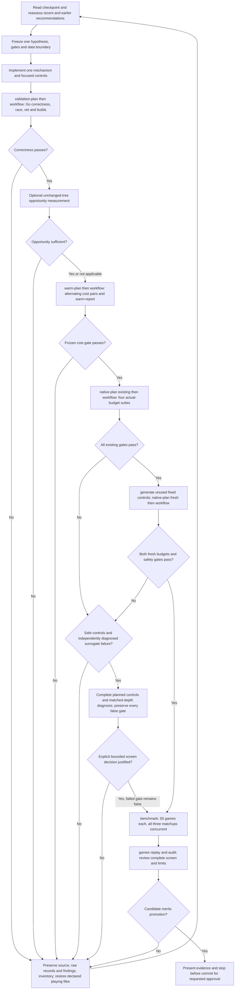

# Repeatable research with bounded model involvement

Start with the current branch's compact checkpoint and
[research workflow](RESEARCH_WORKFLOW.md). Use the Go tools for deterministic
execution, comparison and evidence handling. Model reasoning belongs at hypothesis
selection, unusual failures and final interpretation. An agent should not rebuild
the same orchestration for every attempt or repeatedly read raw principal variations.

Keep reassessment bounded: compare at most three evidence-supported alternatives
in a short note, select one next measurement and let Go complete the frozen plan.
Use an unchanged-tree opportunity test before building speculative pruning or
ordering machinery when headroom is unknown. Do not expand the general tooling
for a one-off hypothesis. During execution, update the compact checkpoint and
that attempt's conclusion; consolidate the full research index at a milestone
instead of rewriting every summary after each stage. Preserve raw evidence and
all existing quality gates. These limits reduce orchestration/reasoning overhead,
not the checks required before promotion.



The agent selects and implements the hypothesis and performs the final review.
Go executes a frozen protocol between those decisions. A failure returns to
reassessment; it does not trigger a favorable rerun, coefficient sweep or larger
confirmation. Local research authorization does not authorize live play or publication.

## Tool responsibilities

| Command | Responsibility |
| --- | --- |
| `snapshot` | Capture the core Go overlay, module metadata, base commit and source hash once; refuse overwriting it. |
| `replay` | Reconstruct a tagged base plus declared Go overlay/test; optionally test/build. |
| `validation-plan` | Produce normal/race/vet checks followed by test/engine builds; a failed check stops before later stages. |
| `warm-plan` | Produce three alternating baseline/candidate pairs and their declared cost/exactness gate. |
| `warm-report` | Check coverage, complete depth, legal moves, determinism, optional exactness and frozen numeric gates; retain per-pair details. |
| `native-plan` | Produce the existing four-suite or fresh two-suite schedule using unchanged `choices` quality rules. |
| `workflow` | Execute argv without a shell, serialize stages, log commands/results, verify identities and stop on failure. |
| `generate` | Collect the fixed 16-family offline rollout with declared seed/stream and canonical exclusions. |
| `choices` | Run equal-time native requests before reference queries; retain all records and a compact `brief.json` with adverse case IDs. |
| `depth-review` | Diagnose all changed choices in completed native suites at observed depths using both pinned binaries; verify co-best alternatives separately. No timed actor query is repeated. |
| `confirm-mates` | Query every saved new mate flag at a fixed larger budget, including the unrestricted root and both actors' complete move union. Preserve original gates and raw records. |
| `benchmark` | Run the established concurrent three-opponent game screen. |
| `games`, `inventory`, `audit` | Legally replay games, seal completed evidence and verify archived hashes. |
| `map-docs` | Record explicit authorized historical-document edits in the legacy migration map without changing original hashes or raw evidence. |

There is one runner, with small builders for validation, warm and native schedules.
The tools do not choose hypotheses, adjust gates, fit weights, restore arbitrary
working files, publish code or start live play. Historical one-off drivers remain
as evidence; they are not templates to copy for new work.
When research changes the tooling itself, `snapshot --include 'tools/research/*.go'`
also preserves that executable's Go sources in the replayable overlay. The
experimental `context-fit` command follows its own frozen model plan; it is not
an automatic stage of routine engine research.

## Preparation and warm work

Build the research executable once per tooling revision, before any measurement:

Use a writable, fixed Go cache when the sandbox cannot write the platform
default; keep that environment setting consistent throughout a run. Current
run states record the chosen cache and Go/runtime environment.

```sh
go build -buildvcs=false -o tools/benchmark/bin/research ./tools/research
```

Prepare a tagged baseline test executable once per release/harness/toolchain.
The optional [warm harness](../research_warm_test.go) validates all 20 recorded
games, their openings/history, every completed root and every selected move.
It skips unless an explicit workload/output is supplied. Its default protocol
uses the frozen first 20 games from the v0.21 rank-order screen: all ten openings,
1,145 candidate turns, persistent per-game tables and complete depth five.

```sh
tools/benchmark/bin/research replay --base v0.22 --test research_warm_test.go \
  --out /tmp/pandafish-warm-v022
go -C /tmp/pandafish-warm-v022 test -c -o /tmp/pandafish-warm-v022.test .
```

Build/check the candidate through the shared fail-closed schedule:

```sh
tools/benchmark/bin/research validation-plan \
  --candidate tools/benchmark/bin/pandafish-candidate \
  --candidate-test /tmp/pandafish-candidate.test \
  --out tools/benchmark/research/ATTEMPT/validation-plan.json
tools/benchmark/bin/research workflow \
  --plan tools/benchmark/research/ATTEMPT/validation-plan.json \
  --out tools/benchmark/research/ATTEMPT/validation-run
```

Build the candidate test executable again after a source change. Do not overlap
builds, profiling or validation with cost/native/game measurements. Run only one
workflow per repository; Darwin/Linux enforce an OS measurement lock, released
even if the runner exits unexpectedly. Internal native workers and the concurrent
three-opponent match are the intended controlled concurrency.

Run correctness, race/vet and builds as separate checked calls or one fail-closed
`workflow` plan. Never combine dependent test/build/timing commands in a multiline
shell invocation whose final exit can hide an earlier failure. New warm plans use
`--preflight-state VALIDATION_RUN/state.json`: plan creation rejects failed or
source-stale validation, and execution pins/checks the passed state again.
The initial v0.23 selective prototype's accidentally started/interrupted cost
records remain evidence of why this prerequisite was added.

Create an evidence directory and then generate its plan. Example: an exact
candidate with a prospectively chosen 15% elapsed-saving target:

```sh
tools/benchmark/bin/research warm-plan \
  --baseline-test /tmp/pandafish-warm-v022.test \
  --candidate-test /tmp/pandafish-candidate.test \
  --input tools/benchmark/research/v0.21-rank-order/screen/v0.21-rank-order-dev-vs-v0.20-and-stockfish-3-and-sacrifice-v0.2.0-b528f0ba \
  --evidence tools/benchmark/research/ATTEMPT/warm \
  --out tools/benchmark/research/ATTEMPT/warm-plan.json \
  --depth 5 --roots 1145 --max-time-ratio 0.85 --exact \
  --preflight-state tools/benchmark/research/ATTEMPT/validation-run/state.json
tools/benchmark/bin/research workflow \
  --plan tools/benchmark/research/ATTEMPT/warm-plan.json \
  --out tools/benchmark/research/ATTEMPT/warm/run
```

Targets are per-hypothesis decisions, not universal repository thresholds. A
valuation/selectivity candidate omits `--exact` and uses its own frozen cost
limit. `--reference` compares a computational rewrite against its original
candidate rows. `--max-node-ratio` adds an early deterministic gate after each
pair; a failed node criterion stops before further timing pairs. An opportunity
diagnosis can use `warm-report --pairs 1 --exact --min-opportunity FRACTION` with
no timing gate. Instrumented elapsed times are not performance evidence.

## Native controls and fresh data

After correctness/cost pass, freeze a candidate executable and generate the
existing schedule. Replace the example paths once; do not change the generated
plan during a run:

```sh
tools/benchmark/bin/research native-plan \
  --baseline tools/benchmark/bin/pandafish-v0.22 \
  --candidate tools/benchmark/bin/CANDIDATE \
  --cache tools/benchmark/research/v0.22-bitboard-exchange \
  --evidence tools/benchmark/research/ATTEMPT \
  --out tools/benchmark/research/ATTEMPT/native-plan.json
tools/benchmark/bin/research workflow \
  --plan tools/benchmark/research/ATTEMPT/native-plan.json \
  --out tools/benchmark/research/ATTEMPT/native-run
```

The existing profile retains public 100ms/three trials, public 1000ms/one,
newer 100ms/one and newer 1000ms/one, three native workers, and both-turn gates
for newer inputs. Cached reference work still requires the matching teacher,
node budget and completed archive. No native choice is reused as a new timing.

Only after those gates pass, collect a new prospectively frozen seed using
`generate --seed NUMBER --stream NUMBER`. Repeat `--exclude-input PATH_OR_GLOB`
for public/newer/consumed control inputs and `--exclude-analysis GLOB` for saved
live analysis. For v0.23, include both consumed quiet-check and phase-activity
cohorts and all v0.22 live survey boards. The old blocked/forest boundary remains
automatic. Every extra source/hash and exclusion is recorded. No copied
generator program or candidate-selected rollout is needed.

Use `native-plan --profile fresh --input .../fresh-generation/inputs.json` for
the two fresh budgets; it reuses only matching completed reference observations
from its first budget. The candidate and final cohort remain fixed. The ordinary
[benchmark profile](../tools/benchmark/README.md#test-a-development-candidate)
then supplies 50 games each versus the tagged release, Skill 3 and pinned
Sacrifice, all three concurrent. No automatic larger confirmation follows.
Invoke that benchmark directly; it already preserves commands, identities,
settings, scores and PGNs. Its Markdown report is `RESULTS_ROOT/README.md`,
while named matchup directories contain JSON/PGN evidence. Do not copy a second
screen wrapper with guessed output paths. A report-path failure after complete
play never authorizes rerunning games.

A failed surrogate normally stops the candidate. Exact-value efficiency changes
can reach a worse pre-existing horizon, as documented for v0.22. Before any
exception, use `depth-review --baseline PATH --candidate PATH --input
'ATTEMPT/*/native.json' --out NEWDIR` to compare every changed choice, including
improvements, at observed depths. Selective policies additionally need an
independent full-depth regret/mate review. Use the original tag when the horizon
is unchanged; when a candidate deliberately changes it, use an unreduced
same-horizon reference with isolated tables and keep original-tag equal-time
comparisons separate. A larger-budget
`confirm-mates` check and `depth-review --flags-only` can diagnose every reported
mate flag, without proving that a finite reference alternative is saveable.
Keep the original gate false and preserve its
failed run. Any justified one-screen exception requires a separate written
decision and new plan before matches; it cannot waive legality, cancellation,
timing or new losing-mate failures. It does not justify a favorable retry or
an automatic promotion. See the [v0.23 decision](../tools/benchmark/research/v0.23-root-parallel/SCREEN_DECISION.md).

## Status, failures and context handoff

`workflow` records its frozen plan, input hashes, each command, exit/error,
gate summaries, output hashes and duration. All stdout/stderr stays in per-step
logs. Commands are repository-root argv, with optional environment overrides,
timeouts, required output globs and JSON-pointer equality gates. A successful
exit alone cannot pass a failed `passed:false` report.
Relevant Go/runtime environment settings are recorded and must match on resume.

```sh
tools/benchmark/bin/research workflow --out RUN_DIRECTORY --status
tools/benchmark/bin/research workflow --plan PLAN_FILE --out RUN_DIRECTORY --resume
```

Resume checks input/plan/output identities and skips only completed passed
steps. Failed or interrupted steps are not rerun or bypassed. Keep partial data;
diagnose the interruption and document any separately authorized recovery.
Darwin/Linux timeout/cancellation kills the step's process group, including
engines. Other platforms use direct-process cancellation and an exclusive-file
lock; multi-process timeout cleanup/stale-lock recovery is not equivalent.

Do not poll raw files every few seconds. Let the runner finish deterministic
stages, use bounded tool waits around 45 seconds and read compact state only at
a stage transition, failure or requested status. Keep user updates concise.
Inspect raw records only to explain a specific anomaly; start with `brief.json`.
Do not start model agents to monitor processes or perform arithmetic.

Before switching candidates, preserve source and raw records, write a short
conclusion and run `inventory --dir COMPLETED_ATTEMPT`. Never regenerate an
old inventory to hide changed evidence. `audit` verifies all inventories;
`games --dir SCREEN` checks legal game records. Maintain one compact checkpoint
with active source state, completed gates, exact pending command and links to
failures. Future contexts read that checkpoint and this guide first, then only
the relevant evidence. Raw observations remain the authority.

Authorized edits to historically mapped Markdown guides require `map-docs`
before `audit`. Pass only the changed mapped files and a new transition record,
for example `map-docs --file AGENTS.md --file tools/README.md --record PATH.json`.
The command changes only current document mappings, preserving original hashes,
retired-source metadata and raw observations. New documents need no legacy map.
