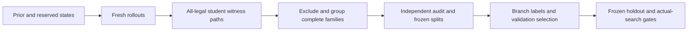

## Publication note for v0.19

The original local experiment report below retains its stop/check-in state.
These attempts were subsequently approved for publication together in v0.19.
Playing policy remains v0.18; the [release summary](/docs/RESEARCH_V019.md)
and [Go tooling guide](/tools/research/README.md) describe current status and
replace historical script commands. Original source remains in the hashed
release attachment.

## v0.19 tooling migration

This historical report retains its original measurements. Python/shell runners
were retired in v0.19; commands below describe the original experiment.
Current verification uses the [Go research tools](/tools/research/README.md).
Original scripts and unedited evidence remain in the [hashed release archive](https://github.com/philyawj/Pandafish/releases/download/v0.19/v0.19-historical-research-evidence.tar.gz).

# Repaired family boundary and fresh evaluation fit

**I keep the pipeline repair and recommend revising the evaluator, with no
promotion.** The frozen fit passes its surrogate gate and improves fresh finite-
CP decisions, but fails the public short-budget gate and the fresh long-budget
mate guard. I archived it and restored the working playing source to v0.18.
No strength screen, new commit, push or PR followed.

I selected this revision after the first post-v0.18 branch fit failed its
holdout and a stricter audit found early transpositions. I keep that original
batch intact in [the earlier report](../v0.19-decision-evaluation/README.md).
This new directory repairs the data boundary and doubles the rollout families,
with the same feature representation, fitting objective and regularization grid.
It is local research, not a v0.19 release or an approved playing change.

The earlier fitted evaluator published inside v0.18 failed **before** PR #33
merged. The first branch-objective batch failed **after** that merge and remains
local. This repaired batch follows it. I preserve failed attempts in the
research archive for the next approved PR rather than create a release per fit.
The released v0.18 tag and active bot/config remain unchanged.

## Boundary design and controls

[PLAN.json](PLAN.json) freezes the effective design before tests/engines/labels.
[PLAN-pre-design.json](PLAN-pre-design.json) retains the initial draft; the
precollection refinement includes every legal root alternative's exact released
search witness **before assigning components/splits or collecting branch labels**.
This avoids discovering overlap only after fitting. The repair uses canonical
board states, not first-four-move strings.

I canonicalize placement, turn, castling rights and legally usable en passant,
including color/rank mirrors and ignoring counters. I track positions from
ply four onward, transitively group related families, and exclude complete
families touching prior/reserved states. Earlier queried exact PVs, full rollout
histories, witness paths, controls and the reserved confirmation suite contribute
40,058 blocked states from ten byte-hashed inputs.

Six pre-engine boundary tests cover early transposition positives, distinct
negatives, mirrors/counters/rights, legal/unusable en passant, transitive groups,
forced bad splits, late blocked states and terminal roots. Two further logger
regressions verify that terminal nulls are recorded while a missing live move
still fails. [boundary-tests.txt](boundary-tests.txt) and
[query-controls.txt](query-controls.txt) retain the results.

The independent auditor rebuilds every board/path and computes graph components
with a different algorithm. It does not trust stored keys or component labels.
It checks the all-legal witness coverage, whole-component assignment, prior and
reserved exclusions and absence of cross-split states before labels; it repeats
that check after selecting labelled alternatives.

## Fresh corpus and surrogate result

Seeded MultiPV-eight opening exploration and alternating offline tagged-v0.18 /
finite-node full-strength Stockfish rollouts yield 80 accepted families in 86
attempts and 417 sampled roots. All six rejected attempts remain raw. These are
training rollouts, not strength matches or a production opening book.

The prelabel forest covers every legal alternative: 14,167 legal paths/FENs,
with 13,864 static-leaf geometry/scalar checks matching independent Python-chess
and integer expectations. Family grouping yields **76 connected components**.
Both independent audits pass, with zero blocked hits or cross-split positions.
The frozen raw split is 246 train / 82 validation / 89 holdout roots.

The scheduled sample plies are all even, so all 417 fresh decision roots are
White to move. Alternating student color does not balance root turns. Scalar/
color symmetry checks validate implementation, not Black-to-move decisions.
[coverage-diagnosis.json](coverage-diagnosis.json) preserves this limitation;
a future balanced or mirrored decision cohort must be planned and grouped
before labels. Component-disjoint states under this boundary also do not imply
statistically independent chess patterns or teacher errors.

Branch alternatives combine three finite-reference moves and the unrestricted
student's actual 100 ms move. Restricted labels use fresh-hash 50,000-node
searches; every score-bearing iteration/bound and last exact estimate remains
raw. Labelled alternatives reuse the prelabel witnesses exactly. The reference
is an estimate, and any similarly good alternative counts; no production move
is forced. Opening-pool width, data size and the boundary changed together, so
I do not attribute any outcome solely to the boundary bug fix.

After the unchanged mate/nonstatic/incomplete-root exclusions, 223 training,
74 validation and 81 holdout roots remain, with 567 informative training pairs.
Validation selects ridge 1; [model-weights.json](model-weights.json) is written
before the first holdout metric. The objective retains its 25 cp uncertainty
band and severe-error guard. No holdout retuning occurred.

| Frozen-leaf mean regret | Unchanged model | Selected fit |
| --- | ---: | ---: |
| Training, 223 roots | 30.82 cp | 27.35 cp |
| Validation, 74 roots | 30.73 cp | 28.91 cp |
| Holdout, 81 roots | 61.12 cp | 56.02 cp |

The **8.35% holdout improvement** passes the >=5% gate. Severe (>300 cp) counts
change 3→2 in training, stay 1→1 in validation and 4→4 in holdout. This is a
frozen-student-leaf surrogate, not a measured improvement in candidate search
or playing strength. Every grid fit, excluded root and selected decision stays
in [fit-results.json](fit-results.json).

[The post-fit representation diagnosis](representation-diagnosis.json) finds
full rank across the 24 training columns. Its optimistic identical-feature
regret floor is only about 0.24 cp on holdout; exact feature collisions do not
explain most residual error in this subset. This does not establish that the
linear model is expressive enough, that a neural model would win, or that the
frozen-leaf approximation predicts actual search.

## Active candidate correctness and cost

After the surrogate gate passes, I activate only the frozen coefficients under
the distinct identity `Pandafish v0.19-independent-evaluation-dev`. The tested
candidate adds the compact residual to the unchanged v0.18 base. It is archived
after the failed actual-search gates; the current working source is v0.18.
[scope-proof.json](scope-proof.json) verifies the original base formulas and
protected search/quiescence/table/history/clock files remain exact.

All 13,495 unique static-FEN scalar/perspective fixtures pass. The full normal
and race suites, vet, native/ARM64 builds, offline placeholder-config wrapper,
upstream library race tests, 192 completed/legal cold fixed-depth probes and
history-contamination control pass. Evaluation/material base invariants remain.
The old material-only capture/EP score tolerances are replaced with independent
unpruned minimax, preserving exact material units and tactical gains; the two
original failures and contracts remain in [ERRATA.md](ERRATA.md).

The fitted evaluator measures 257.7 ns/op versus 49.2 ns/op for the exact base
and 206.0 ns/op for feature extraction, all zero-allocation. It passes the
predeclared <=400 ns combined gate. These are component costs, not total engine
speed or strength. New positional values can legitimately change search nodes,
scores and moves; exact baseline score parity is not this candidate's claim.

## Actual-search validation

[ENGINE_PLAN.json](ENGINE_PLAN.json) freezes the actual-choice gates before
native probes. Existing public controls use the full 2,046-request serial,
three-search and warm schedule. All 89 raw fresh holdout roots additionally use
serial 100 ms / three trials and 1,000 ms / one trial. Source/binaries/weights
stay frozen and no other engine probes overlap timed blocks.

All 2,758 native requests complete correctly: 2,730 legal nonterminal results
and 28 expected terminal nulls. Every response stays within requested time plus
50 ms. The model averages about 0.07–0.12 fewer completed plies across measured
groups; its extra evaluation cost and changed pruning both affect work. Every
shallower pair remains in [shallower-native-pairs.json](shallower-native-pairs.json).
[native-analysis.json](native-analysis.json) retains all budgets, loads and timings.

Actual selected moves are scored with full-history, fresh-hash 100,000-node
references: 477 distinct queries, including 206 unchanged cached public-control
queries. All iterations and exact results remain in
[actual-decision-reference.json](actual-decision-reference.json). Alternatives
are scored by value rather than equality to a unique reference move.

| Actual-search diagnostic | Finite positions | Baseline mean loss | Model mean loss | Severe baseline/model | Gate |
| --- | ---: | ---: | ---: | ---: | --- |
| Public controls, 100 ms | 67 | 55.27 cp | 68.04 cp | 1 / 3 | Fails mean-loss gate |
| Public controls, 1,000 ms | 67 | 68.00 cp | 66.12 cp | 3 / 3 | Passes |
| Fresh holdout, 100 ms | 80 | 78.50 cp | 63.24 cp | 4 / 3 | Passes |
| Fresh holdout, 1,000 ms | 80 | 68.89 cp | 54.66 cp | 3 / 2 | Fails separate mate guard |

Fresh finite-CP mean loss improves about 19.4% and 20.6%; public 100 ms loss
worsens about 23.1%. Mate-valued positions remain separate (17 public / 9 fresh
at each budget). The fresh long-budget guard flags one new selected losing-mate
line. [actual-decision-quality.json](actual-decision-quality.json) retains every
case and guard result. The overall predeclared gate **fails**; no standard
strength matches or larger confirmation run. These are finite-reference search
diagnostics, not a measured Elo gain or evidence that the candidate necessarily
loses more games.

## What the failures establish

[The saved diagnosis](failure-diagnosis.json) uses existing records only, with
no new favorable rerun or weight adjustment. In the Ruy Lopez control, both
native actors complete depth five, yet v0.18 castles while the candidate plays
`...Nd4`. At fixed depth four, the same preference differs. The English queen
retreat also differs at equal depth. Extra inference cost is therefore not a
complete explanation for the public regressions. The records do not identify
one coefficient as the sole cause.

The fresh guard case `fresh-024-ply48` is already badly lost: unrestricted
reference about -1,044 cp. The candidate's `Rg1` allows a reference mate in four,
while baseline `c5` receives a finite -1,141 cp estimate. This is a conservative
survival diagnostic, **not proof that the model turned a drawable position into
a loss** or that the baseline can save it. Even without this guard, the separate
public 100 ms gate still fails.

Crucially, `Rg1` was already labelled mate -4 in the 50,000-node corpus. The
root was excluded from the surrogate because one alternative had a mate score.
It is a holdout root and must never be fitted; the issue is that the same
whole-root exclusion rule also removed 22 mate-containing training roots and
seven validation roots. The surrogate did not test this class of sharp choice.
That supplies a concrete supervision gap to investigate, not a guarantee that
adding the missing constraint would fix this candidate.

The clean boundary successfully addresses the earlier overlap. The same compact
representation now finds held-out surrogate and actual finite-CP gains, which
supports continuing the research. It still does not preserve all important
behaviors. [NEXT.md](NEXT.md) prioritizes sharp/mate-containing branch coverage
and training-only negative alternatives before another fit; no inspected
holdout is reused as a blind test.

## Preservation and current state

[candidate-source.json](candidate-source.json) freezes the complete tested
source overlay and scalar fixture over tagged v0.18. [reproduce.py](https://github.com/philyawj/Pandafish/releases/download/v0.19/v0.19-historical-research-evidence.tar.gz)
restores it in a new directory and runs tests/build without games. The clean
source replay passes; [archive-replay-checks.json](archive-replay-checks.json)
and its logs remain intact. I then restored working source to v0.18 and reran
the normal suite successfully, recorded in
[restoration.json](restoration.json) and
[restored-baseline-tests.txt](restored-baseline-tests.txt).

The candidate, both earlier failed fits, all data, errors, mate cases and timing
regressions remain preserved. The [final audit](final-audit.json) verifies the
active baseline, archived source hashes, frozen weights, independent integer
metrics and prior evidence. This is uncommitted research on the local branch.
I will check in before a PR; no live game, private config change, release or
larger confirmation follows this report automatically.
